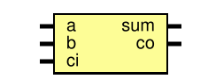

# Entity: full_adder 
- **File**: full_adder.sv

## Diagram

## Ports

| Port name | Direction | Type | Description |
| --------- | --------- | ---- | ----------- |
| a         | input     |      |             |
| b         | input     |      |             |
| ci        | input     |      |             |
| sum       | output    |      |             |
| co        | output    |      |             |

## Signals

| Name   | Type  | Description |
| ------ | ----- | ----------- |
| wire_1 | logic |             |
| wire_2 | logic |             |
| wire_3 | logic |             |
